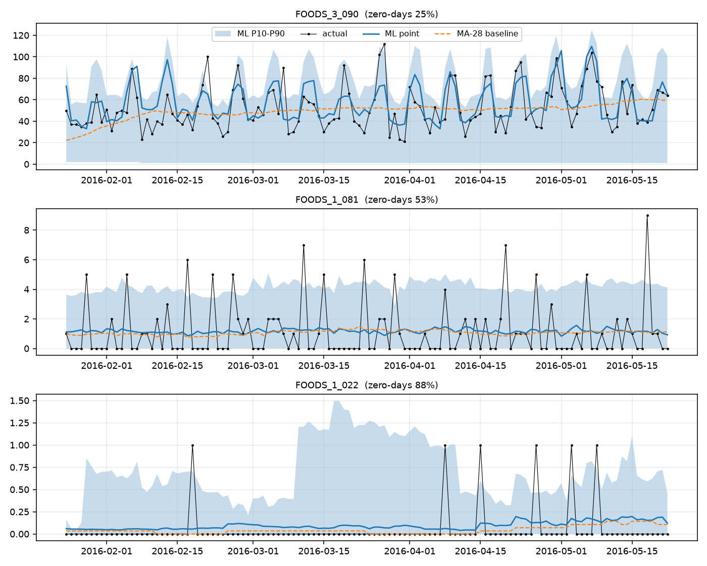
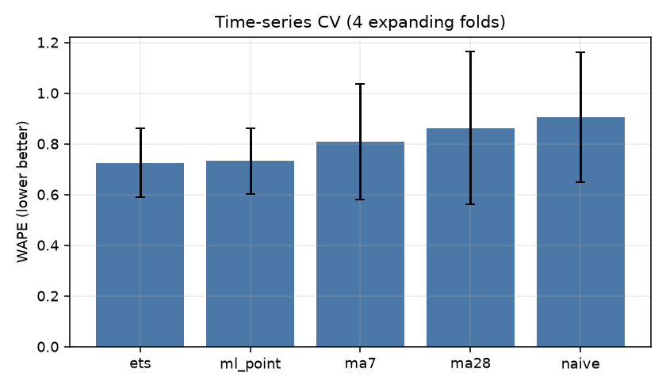
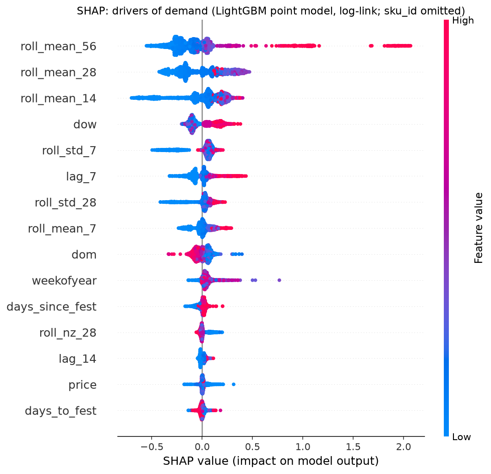
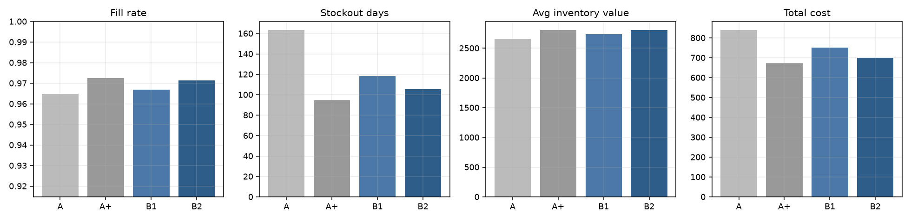
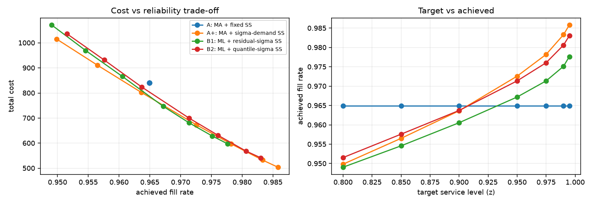
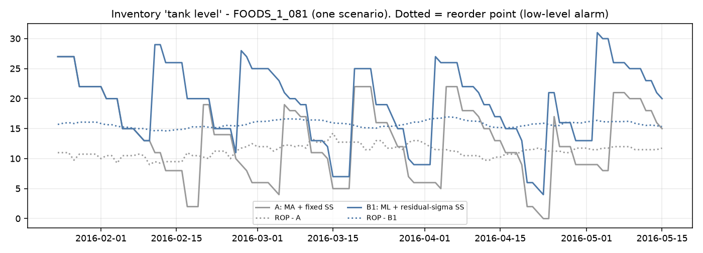

# SupplyIQ results

**Data:** M5 (Walmart) - FOODS, store CA_1 - 60 SKUs, 120-day untouched holdout.

## Forecast accuracy - time-series CV (expanding window, mean over folds)
| model | WAPE | WAPE_std | Bias | RMSE |
|---|---|---|---|---|
| ets | 0.725 | 0.136 | 0.029 | 4.925 |
| ml_point | 0.733 | 0.130 | 0.049 | 4.777 |
| ma7 | 0.808 | 0.228 | 0.030 | 5.943 |
| ma28 | 0.863 | 0.301 | 0.081 | 5.937 |
| naive | 0.906 | 0.255 | 0.029 | 6.474 |

## Forecast accuracy - final holdout
| model | WAPE | Bias | RMSE | n |
|---|---|---|---|---|
| ml_point | 0.563 | -0.014 | 3.230 | 7200 |
| ets | 0.567 | -0.007 | 3.320 | 7200 |
| ma28 | 0.606 | -0.062 | 3.738 | 7200 |
| ma7 | 0.612 | -0.021 | 3.778 | 7200 |
| naive | 0.703 | -0.015 | 4.104 | 7200 |

P10-P90 interval coverage on holdout: **77.3%** (nominal 80%).

ML beats MA-28 on **41/60** SKUs. Split by intermittency (zero-days > 50%):

| intermittent | n | ml_wins | wape_ma28 | wape_ml |
|---|---|---|---|---|
| False | 27 | 21 | 0.787 | 0.774 |
| True | 33 | 20 | 1.124 | 1.285 |

## Inventory policies - Monte Carlo (1000 scenarios, target service level 95%)
| policy | fill_rate | stockout_days | avg_inv_value | orders | holding | ordering | shortage | total_cost |
|---|---|---|---|---|---|---|---|---|
| A: MA + fixed SS | 0.965 | 163.548 | 2,656.903 | 367.181 | 167.421 | 111.562 | 561.605 | 840.589 |
| A+: MA + sigma-demand SS | 0.973 | 94.475 | 2,807.117 | 380.346 | 176.887 | 112.956 | 381.849 | 671.692 |
| B1: ML + residual-sigma SS | 0.967 | 117.941 | 2,734.193 | 376.770 | 172.292 | 110.781 | 468.439 | 751.512 |
| B2: ML + quantile-sigma SS | 0.971 | 105.627 | 2,809.002 | 384.027 | 177.006 | 111.959 | 411.844 | 700.809 |

A = moving average + fixed safety stock; A+ = moving average + z*sigma(demand)*sqrt(L); B1 = ML forecast + z*sigma(forecast error)*sqrt(L); B2 = ML forecast + quantile-spread uncertainty.


## Assumed plant parameters (NOT real plant data)

```
{
  "lead_time_days": 7,
  "lead_time_sd_days": 1.0,
  "holding_rate_per_year": 0.25,
  "unit_cost_ratio": 0.7,
  "order_cost_frac": 0.05,
  "shortage_cost_mult": 0.5,
  "fixed_cover_days": 3.0,
  "service_level": 0.95
}
```







